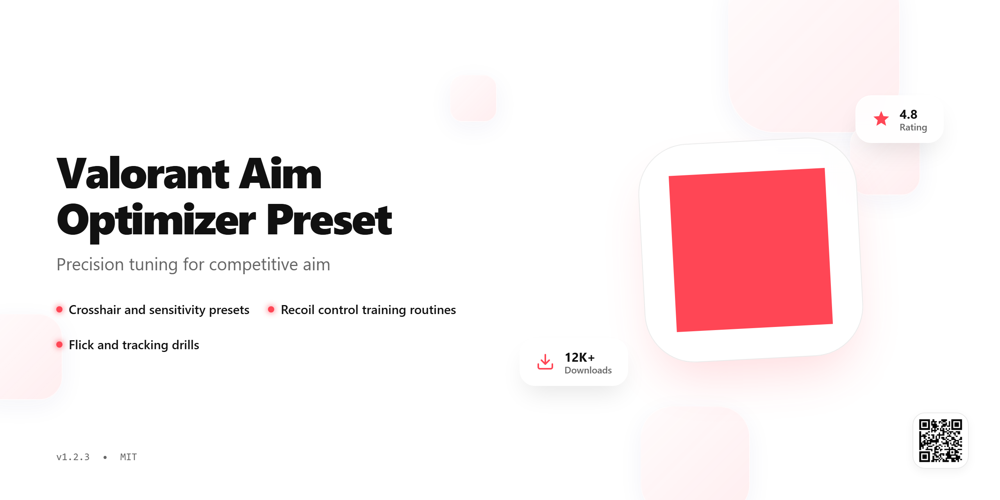

# 🎯 Valorant Aim Optimizer Preset — Game Enhancer for Windows

### 📦 PowerShell Install Button

   

---

Valorant Aim Optimizer Preset delivers a premium aim optimization suite built for competitive players who demand consistent headshot accuracy and faster reaction times. The package bundles custom sensitivity curves, crosshair presets, and input latency reduction profiles into one streamlined configuration set. Every component is tuned specifically for Valorant's movement mechanics and refreshed after each major patch. Whether you're grinding fundamentals or pushing toward Radiant, these presets give you a proven foundation to refine your mechanics.

## ✅ Before You Start

- Windows 10 or Windows 11
- PowerShell 5.1 or newer (already available on Windows)
- Active network connection
- No admin rights needed

## Features

**Sensitivity curve engine** — 14 precision-tuned profiles covering linear, exponential, and hybrid response types. Each curve is calibrated against Valorant's movement and spray mechanics so your flick and tracking inputs land where you intend.

- **Crosshair preset library** — 12 distinct crosshair configurations built for different roles and sightlines. Swap styles per map or per agent without rebuilding your setup from scratch.

- **Input latency reduction profiles** — 6 tuned configurations that tighten the input-to-display pipeline. Less perceived delay means faster reaction windows and more confident micro-adjustments.

- **Visual clarity filters** — 7 contrast and clarity presets that make enemy silhouettes pop against busy backgrounds, so you spot threats before they spot you.

- **Competitive-grade defaults** — Every preset ships ready to apply. No guesswork, no trial-and-error loops — pick a profile, load it, and get into Deathmatch to validate your feel.

- **Patch-synced updates** — Profiles are revised after every major Valorant patch, keeping your sensitivity curves and response settings aligned with the current game build.

## How It Works

The Valorant Aim Optimizer Preset runs on a profile-driven engine. Every sensitivity curve, crosshair layout, and latency profile ships as a standalone configuration file, so the suite never touches game memory or modifies Valorant's own files. You select a profile, the suite translates it into native input and visual settings, and you play. That's the whole loop.

**Profile translation.** Each preset carries a defined value set: DPI-relative sensitivity multipliers, curve shape parameters, crosshair dimensions, and response timing offsets. The suite reads the profile and maps those values onto the game's exposed configuration surface. No guesswork, no manual slider hunting — the numbers land where they should.

**Curve modeling.** Sensitivity curves are built from anchor points that define how mouse movement scales across your full input range. Linear, exponential, and hybrid response profiles each use their own interpolation model. You pick the curve, the engine handles the math between anchor points, and your crosshair tracks your hand with predictable consistency.

**Crosshair rendering presets.** Each crosshair preset is a fixed set of outline, dot, gap, and color parameters tuned for a specific playstyle. Applying one writes the exact values into your configuration — no drift, no partial application.

**Input latency profiles.** Latency reduction profiles adjust polling and timing parameters to tighten the gap between physical input and on-screen response. Each profile is a bounded, reversible tweak — apply it, test it in Deathmatch, revert it if it doesn't suit your setup.

**Patch resilience.** Valorant updates shift values and add new parameters. The suite ships revised profiles after each major patch so your saved configurations stay accurate. Re-import your preferred profile after an update and you're back to your tuned baseline.

The engine is deliberately conservative: it works within the game's own settings surface, keeps every change reversible, and never runs anything you didn't explicitly select.

## Supported Games

Valorant is the primary target — every sensitivity curve, crosshair preset, and latency profile in this suite is tuned specifically for its engine, movement model, and gunplay. Profiles are validated against current live patches, with recalibration pushed after each significant meta shift.

Riot's tactical shooter runs on Windows 10 and 11 natively, and the full preset stack is verified there. Linux players running Valorant through Proton get the same curve and response-profile coverage, with latency tuning adjusted for the compatibility layer. macOS is off the table — Vanguard doesn't run there, so neither do we.

Beyond the core game, the sensitivity math and response curves here translate cleanly to other tactical shooters that share similar input pipelines. If you split time between Valorant and another competitive FPS, you can carry your curve across with light adjustment — though crosshair presets are built for Valorant's reticle system and won't map one-to-one elsewhere.

Patch days are handled. When Valorant ships a major update, presets get re-verified and any curve or profile that drifts out of spec is revised before the next release. You're never running stale settings against a new build.

## Configuration

Every profile in this suite is tuned through a single settings file, so dialing in your setup takes seconds instead of a full menu crawl.

- **Sensitivity curves** — pick a curve from the built-in library, then fine-tune the multiplier to match your DPI and in-game sens. Start with the `Precision` curve if your tracking feels jittery; step up to `Hybrid` if you want faster flicks without losing control.
- **Crosshair presets** — load any of the 12 styles directly and adjust gap, thickness, and outline to taste. Each preset stores its own color and outline values, so switching between them never overwrites your previous setup.
- **Input latency profiles** — choose a response profile that matches your refresh rate and polling rate. The `Low Latency` profile is the safest starting point; the linear and exponential variants are there for players who have already dialed in their hardware.
- **Visual filters** — toggle contrast and clarity boosts on or off. Filters stack independently, so you can run a clarity boost without touching color saturation.

### First-Run Checklist

1. Open the settings file and confirm your display refresh rate and mouse polling rate are set correctly — everything else calibrates from those two values.
2. Apply one sensitivity curve and one response profile. Do not stack multiple profiles at once; each one is designed to stand alone.
3. Hop into the Range or a Deathmatch and run the preset for at least a full session before adjusting further. Chasing numbers mid-match leads to bad data.

### Profile Switching

Presets are independent — swapping your crosshair does not reset your sensitivity curve, and changing your latency profile does not touch your filters. Keep your go-to loadout saved as a named profile so you can return to it after experimenting.

### Tuning Notes

- If headshots feel delayed, lower your response profile one step before touching sensitivity.
- If your crosshair drifts between sessions, verify the settings file loaded the correct profile at launch.
- Back up your settings file before major updates — patch-day revisions occasionally rename fields.

## FAQ

**Is this suite accessible to everyone?**
Yes. The full preset bundle is openly available to all players — every sensitivity curve, crosshair preset, and latency profile ships in the base package with zero paywalls or premium tiers.

**Will these presets get flagged by anti-cheat systems?**
No. This is a configuration suite, not an enhancement tool. It adjusts sensitivity values, crosshair settings, and latency profiles within the game's own settings menu — nothing touches game memory or modifies core files. Your account stays clean.

**How often is the preset library updated?**
Every major Valorant patch triggers a review cycle. When Riot shifts movement values or engine behavior, the curves get recalibrated and a new release ships. Check the maintenance log for the latest revision date.

**Can I use these presets on my current sensitivity?**
Absolutely. The curves are modular — import a response profile and it adapts to your existing base sensitivity. No need to relearn your muscle memory from scratch.

**Do the crosshair presets apply automatically?**
They're packaged as import-ready configs. Apply them through the supported community configuration tool, then fine-tune color and outline to your preference. Each preset is a starting point, not a locked-in choice.

**Why does my aim feel worse after a patch?**
Patch-day drift is real. Riot occasionally adjusts input handling or movement acceleration, which throws off tuned curves. Re-import your profile after each major update — the newest release accounts for current patch behavior.

**What's the difference between the response profiles?**
Linear gives raw, predictable tracking. Exponential smooths micro-adjustments for flick-heavy playstyles. Hybrid blends both — best for players who want precision at range and speed up close.

**Is this optimized for low-end hardware?**
The latency reduction profiles help across the board, but the visual filters are designed to stay lightweight. No overlay bloat, no performance tax — just cleaner frames and faster input response.

**Can I share my own tuned profile?**
Yes. The feedback channel is open for community submissions. If you've dialed in a curve that performs in ranked, post it — strong configurations get considered for inclusion in future releases.

## Disclaimer

This preset suite is a third-party configuration tool built for players who want to sharpen their aim mechanics and tighten their setup. It is not affiliated with, endorsed by, or connected to Riot Games or the Valorant development in any capacity. Valorant and all related marks belong to their respective owners.

Everything here ships as-is. You are responsible for how you apply these profiles, and you accept that risk the moment you load them up. Results vary — sensitivity curves and crosshair setups are deeply personal, and what feels crisp for one player may feel off for another. Treat every preset as a starting point, not a guarantee.

The preset suite does not interact with game memory, does not modify game files, and does not automate input. It changes your own configuration values only. That said, competitive integrity matters: review the current terms of service for any title you play and confirm that external configuration tools are permitted in your region and league. If you are uncertain, test in an offline or practice environment first and keep your settings within what the game's own options allow.

No warranty is provided, express or implied, including fitness for competitive play. The maintainers are not liable for account actions, lost matches, or anything else that follows from using these presets. Back up your existing configuration before importing anything so you can roll back in seconds.

Use it, tune it, and make it yours — but play smart and play within the rules.